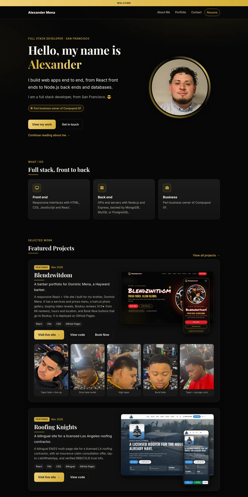
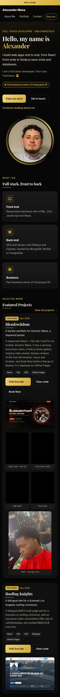

# React-Portfolio 

## Description

This is my new React portfolio, here i show all the cool and amazing thing i can with react

## Table of Contents

[Description](#Description) [Installation](#installation) [Credits](#credits) [License](#license) [Usage](#usage) [Featured work](#featured-work) [Images](#Images) [Questions](#questions) [Github](#github) [Links](#links)

## Installation

You need to do a npm i, than do a npm build

## Credits

Office hours, xpertlearning assistant

## License

## Featured work

**[Blendzwitdom](https://alexm415.github.io/Blendzwithdom/)** — A responsive React + Vite barber portfolio for Dominic Mena, a Hayward barber. [Live site](https://alexm415.github.io/Blendzwithdom/) · [Code](https://github.com/Alexm415/Blendzwithdom)

**[Roofing Knights](https://alexm415.github.io/RoofingKnights/)** — A bilingual EN/ES multi-page site for a licensed LA roofing contractor, with an insurance-claim consultation offer, tap-to-call/WhatsApp, and verified BBB/CSLB trust info. [Live site](https://alexm415.github.io/RoofingKnights/) · [Code](https://github.com/Alexm415/RoofingKnights)

## Images

Desktop preview of the current portfolio, including the Blendzwitdom and Roofing Knights featured blocks:

Mobile preview:

## Usage

To display my work!😎

## Questions

mena.alex5@gmail.com

## Github

https://github.com/Alexm415

## Links

https://github.com/Alexm415/React-Portfolio

https://reactportfolio415.netlify.app/
